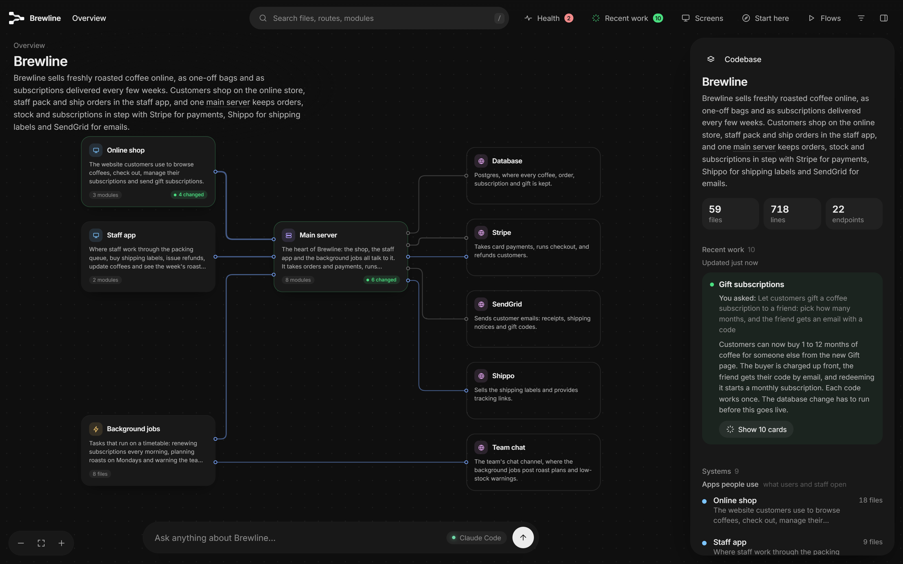
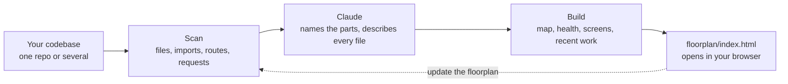

<div align="center">

<picture>
  <source media="(prefers-color-scheme: dark)" srcset="docs/images/logo-dark.png">
  
</picture>

# Floorplan

**See how your app actually fits together.**

Claude reads your codebase and draws an interactive map of it. Every part, file and web request gets a plain-English name, and every connection between them is shown.

[](https://code.claude.com/docs/en/overview)
[](CHANGELOG.md)
[](LICENSE)
[](https://nodejs.org)
[](#how-it-works)

[Install](#install) · [Quick start](#quick-start) · [Features](#features) · [How it works](#how-it-works) · [Docs](docs/README.md) · [FAQ](#faq)

</div>

<!--
  WALKTHROUGH VIDEO: on github.com, edit this README and drag your .mp4 (up to 10 MB on free plans,
  100 MB on paid) into the editor. GitHub uploads it and inserts a https://github.com/user-attachments/...
  link. Put that link on its own line here (replacing this comment) and it plays inline.
-->

<!--
  SCREENSHOT: save it as docs/images/overview.png, then replace this comment with:
  <p align="center"></p>
-->

## Why Floorplan?

You built an app, probably with a lot of help from AI, and it works. But ask "what happens when someone checks out?" or "what breaks if I change this?" and the honest answer is *no idea*.

Floorplan gives you the diagram nobody drew. Ask Claude for a floorplan and a few minutes later you have a map you can explore, ask questions on, and keep up to date as you work.

- **For builders:** understand the app you made, in your own words, without reading the code.
- **For teams:** onboard someone in minutes, from the big picture down to the exact file.
- **For working with Claude:** after every change, see exactly which parts it touched and why.

## Features

<table>
<tr>
<td width="50%" valign="top">

**🗺️ A map at every zoom**<br>
Start with the whole app, then double-click into a part, a group of files, a file, and its endpoints. Each view shows what it's used by and what it uses.

</td>
<td width="50%" valign="top">

**💬 Plain English everywhere**<br>
"Takes card payments at checkout", not "Stripe API wrapper". Technical terms are explained on hover, and one switch shows the developer view.

</td>
</tr>
<tr>
<td valign="top">

**🔌 Real connections, across repos**<br>
It follows imports, and matches each web request in your frontend to the server endpoint that answers it, even across separate repos.

</td>
<td valign="top">

**🖥️ Start from a screen**<br>
Pick a page you know and see everything behind it: its parts, the requests it makes, the server code, the data, and outside services.

</td>
</tr>
<tr>
<td valign="top">

**🧭 Ask the map**<br>
"How does a refund reach the customer's card?" comes back as an answer plus a mini-map of just the pieces involved, with a step-by-step walkthrough.

</td>
<td valign="top">

**🩺 Health check**<br>
Finds passwords in code, endpoints anyone can use without signing in, unused files and files too big to edit safely. Each comes with a ready-to-paste fix.

</td>
</tr>
<tr>
<td valign="top">

**🟢 Recent work**<br>
The cards Claude just changed light up green, each with a note on how the change serves what you asked for.

</td>
<td valign="top">

**⚡ Stays current, stays yours**<br>
Updates re-read only what changed, and an open map reloads itself. Everything runs on your machine, and nothing is committed to git.

</td>
</tr>
</table>

Plus guided **flows** you can request in plain words, a one-minute **Start here** tour, search, keyboard shortcuts, and right-click actions on every card.

## Install

You need [Claude Code](https://code.claude.com/docs/en/overview) (the desktop app's Code tab or the CLI) and [Node.js 18+](https://nodejs.org).

```bash
claude plugin marketplace add haydenschmitty/floorplan
claude plugin install floorplan@floorplan
```

Start a new session and it's ready. Installing the Claude Code CLI is recommended even if you use the desktop app, because it lets the map's Ask bar read your real code. More in [Getting started](docs/getting-started.md).

## Quick start

1. Open your project in Claude Code. For a frontend and backend in separate repos, open the folder that holds both.
2. Ask:
   > Make me a floorplan of this app.
3. Explore. The map opens on its own, starting with a short tour.

When you've done more work, ask:

> Update the floorplan.

Only what changed is re-read, and what you just worked on lights up under **Recent work**.

### Things to try

| Ask Claude | Ask the map |
|---|---|
| "Make me a floorplan of this app" | "What happens when someone places an order?" |
| "Update the floorplan" | "Where do we talk to Stripe?" |
| "Fix the important issues from the floorplan's Health check" | "If I change the users table, what breaks?" |
| "Add a flow showing how a new user signs up" | "Which files handle login?" |
| "Rewrite the floorplan for developers" | "What did we change for refunds?" |

## How it works



Scripts do the mechanical work: finding repos, parsing code in a dozen languages, matching web requests to endpoints, laying out the map. They're plain Node with no dependencies. Claude does the part only a reader can: deciding what the parts of your app *are*, and saying so plainly. Details in [How it works](docs/how-it-works.md).

**Languages:** TypeScript, JavaScript, Python, Go, Rust, Java, Kotlin, Scala, plus Vue, Svelte and Astro files, with lighter support for others.<br>
**Endpoints:** Express, Koa, Hono, Next.js, Flask, FastAPI, Django, Go's net/http, Gin, Echo and chi, Actix, Axum, Spring.<br>
**Screens:** Next.js, React Router, Vue, SvelteKit, Remix, Nuxt, Astro, Expo, Angular, TanStack.

## What it adds to your project

A `floorplan/` folder holding the map, plus a short section in `CLAUDE.local.md` so future Claude sessions know the map is there. **Neither is committed:** the folder ignores itself in git, and `CLAUDE.local.md` goes in your clone's private ignore list. Your `.gitignore` and other tracked files are never touched. See [What's in your project](docs/project-files.md).

## Privacy

- The scan, the map and its small local server all run on your computer. The server only accepts connections from your own machine.
- Questions on the map go to your own Claude account, through the Claude Code CLI.
- The Health check never stores or shows secret values, only where they are.

More in [Privacy and security](docs/privacy-and-security.md).

## Documentation

| | |
|---|---|
| [Getting started](docs/getting-started.md) | Install, first map, updating, removing |
| [Using the map](docs/using-the-map.md) | Every button, view, shortcut and menu |
| [How it works](docs/how-it-works.md) | The pipeline, connection matching, refreshes |
| [What's in your project](docs/project-files.md) | Every file Floorplan creates, and how to edit it |
| [Privacy and security](docs/privacy-and-security.md) | What runs where, and what leaves your machine |
| [Troubleshooting](docs/troubleshooting.md) | Common problems and fixes |
| [Developing Floorplan](docs/development.md) | Repo layout, local installs, releases |

## FAQ

<details>
<summary><b>Does my code leave my computer?</b></summary>

Only the way Claude Code always works: Claude reads the files it needs to describe your app, through your own account. The map itself is a local file and its server only listens on your machine. If you choose to open the map in the Claude app instead, Claude uploads the map (names, descriptions and structure, not your source code) to your private claude.ai account, and asks first.
</details>

<details>
<summary><b>How long does it take, and what does it cost?</b></summary>

A first map takes a few minutes for a small app and longer for a big one, because Claude describes every file and endpoint. It uses your Claude plan like any other task. Big projects are split across parallel helpers. Updates re-read only what changed, so they're quick and cheap.
</details>

<details>
<summary><b>Do I need the Claude Code CLI?</b></summary>

No. The map works without it. With the CLI, the Ask bar can read your real code to answer questions. Without it, you can ask from the Claude app instead, using the map alone.
</details>

<details>
<summary><b>Will it change or commit my files?</b></summary>

It only writes its own `floorplan/` folder and a section in `CLAUDE.local.md`, and neither is committed. It never changes your code, your `.gitignore` or your `CLAUDE.md`.
</details>

<details>
<summary><b>The names it picked aren't how we talk about it. Can I change them?</b></summary>

Yes. Ask Claude ("rename 'Main server' to 'Shop API' on the floorplan"), or edit `floorplan/architecture.json` and `floorplan/descriptions/` yourself. Your edits are kept on every update.
</details>

<details>
<summary><b>Does it work on monorepos and multi-repo setups?</b></summary>

Yes. Point it at a monorepo, a subfolder of one, or a plain folder that holds several repos side by side. It finds every repo and connects them.
</details>

## Contributing

Issues and pull requests are welcome. See [CONTRIBUTING.md](CONTRIBUTING.md) and [Developing Floorplan](docs/development.md).

## License

[MIT](LICENSE) © 2026 [Hayden Smith](https://github.com/haydenschmitty)
